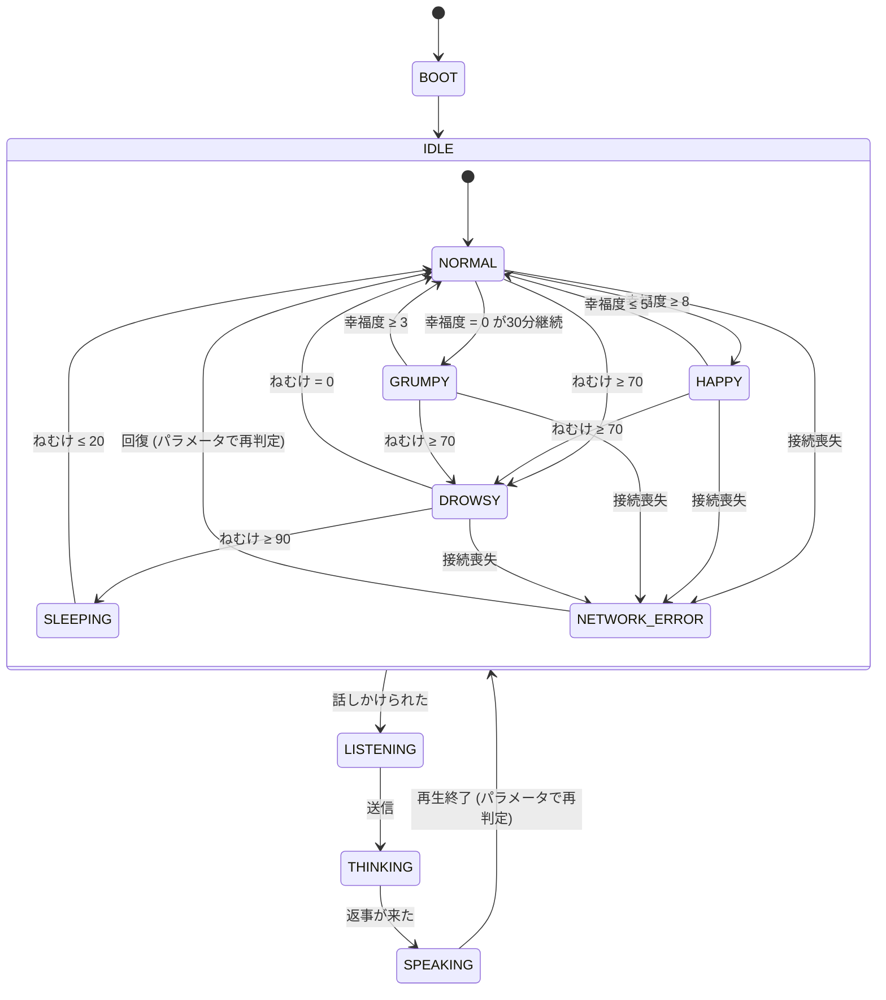

# ミューズロボット 状態遷移モデル v1（サンプル）

SDK の7モードを土台に、IDLE の下へサブステートを作る階層型。
「状態（STATE）」「パラメータ」「トリガー」を分けて記述する。
数値はすべて仮置きのサンプル値で、実機で調整する前提。

## 1. 状態ツリー

```
ROOT
├─ BOOT                起動中 (SDK)
├─ IDLE                待機 (SDK) ─ サブステートを持つ
│   ├─ NORMAL  通常
│   ├─ HAPPY   幸福
│   ├─ GRUMPY  すねてる
│   ├─ DROWSY  ねむい
│   ├─ SLEEPING ねてる
│   └─ NETWORK_ERROR 接続エラー（接続系の致命状態を集約）
├─ LISTENING           録音中 (SDK)
├─ THINKING            返事待ち (SDK)
├─ SPEAKING            再生中 (SDK)
├─ ERROR               SDKエラー (SDK)
└─ OFF                 電源オフ中 (SDK)
```

最上位は SDK のモードだけにし、独自の状態はすべて IDLE の下に置く。

割り込みの優先度（高い方が勝つ）:
`OFF > BOOT > ERROR > LISTENING / THINKING / SPEAKING > IDLE配下`

会話モード（LISTENING等）に入るときは、直前の IDLE サブステートを覚えておく。
ただし会話はパラメータを大きく変える（後述: ねむけ -40、たいくつ -50）ため、
会話が終わったら元のサブステートへは戻らず、その時点のパラメータから再判定する。
結果として、ねてる最中に話しかけられると多くの場合は起きる。

NETWORK_ERROR の置き場所について:
- IDLE のサブステートとし、入るのは起きているサブステート（通常/幸福/すねてる/ねむい）から。
  ねてる間に切断された場合は入らず、接続喪失を記録だけしておき、起きた時点でまだ切れていれば入る
- NETWORK_ERROR の間もパラメータ変化は続くが、サブステート遷移は止まる。
  回復したら固定の状態に戻らず、その時点のパラメータからサブステートを再判定する
- 会話モード（THINKING等）の最中に切断された場合は、SDK のターンが失敗して IDLE に戻った時点で入る。
  会話モード自体は SDK 主導のままにする



## 2. パラメータ（STATEとは別に持つ連続値）

| 名前 | 範囲 | 初期値 | 意味 |
|---|---|---|---|
| happiness（幸福度） | 0〜10 | 5 | 高いと「幸福」に、0が続くと「すねてる」になる |
| sleepiness（ねむけ） | 0〜100 | 30 | 高いと「ねむい」→「ねてる」になる |
| boredom（たいくつ） | 0〜100 | 20 | 高いと一人遊びをし、ねむけの増え方も速くなる |

## 3. トリガー（イベント）

| 名前 | 発生源 |
|---|---|
| HEAD_PET | 頭のタッチセンサー（持続または繰り返しのタッチ＝なでられた） |
| FACE_TOUCH | 顔の短いタッチ（頭センサーの短押し／画面タッチ） |
| CONVERSATION | 会話が1ターン終わった（SPEAKING 終了） |
| TICK_1MIN | 1分タイマー |
| IDLE_10MIN | 最後の関わり（なでる/顔タッチ/会話）から10分経過（繰り返し発火）。パラメータ変更やボタン操作だけではリセットされない |
| SDK_MODE | SDKモードの変化（録音開始・返信開始など） |
| LINK_DOWN / LINK_UP | 接続の喪失／回復 |

遷移の条件には「一定時間の継続」も書ける（例: 幸福度 = 0 が30分継続）。

## 4. パラメータ変化ルール（トリガー → 効果）

| トリガー | 条件 | 効果 |
|---|---|---|
| HEAD_PET | いつでも | 幸福度 +1（上限10）、たいくつ -20 |
| FACE_TOUCH | いつでも | たいくつ -10 |
| FACE_TOUCH | ねむいの時 | ねむけ -10 |
| CONVERSATION | — | ねむけ -40、たいくつ -50（どちらも下限0）。会話すると目が覚めて退屈も解消する |
| IDLE_10MIN | 関わりがない間 | 幸福度 -3（下限0）。放置で幸福度が減る経路 |
| TICK_1MIN | IDLE配下で起きている間 | ねむけ +6、たいくつ +12 |
| TICK_1MIN | ねてる間 | ねむけ -15、たいくつ -15 |

## 5. 遷移ルール（ガード条件 → 遷移）

| 現在 | 条件 | 遷移先 | 備考 |
|---|---|---|---|
| IDLE.通常 | 幸福度 ≥ 8 | IDLE.幸福 | |
| IDLE.幸福 | 幸福度 ≤ 5 | IDLE.通常 | 入口8・出口5のヒステリシス（ちらつき防止） |
| IDLE.通常 | 幸福度 = 0 が30分継続 | IDLE.すねてる | 幸福度の底が続いたときだけ入る |
| IDLE.すねてる | 幸福度 ≥ 3 | IDLE.通常 | なでられて機嫌が直る |
| IDLE.通常 / 幸福 / すねてる | ねむけ ≥ 70 | IDLE.ねむい | |
| IDLE.ねむい | ねむけ ≥ 90 | IDLE.ねてる | |
| IDLE.ねむい | ねむけ = 0 | IDLE.通常 | 顔タッチで ねむけ が削り切られた場合 |
| IDLE.ねてる | ねむけ ≤ 20 | IDLE.通常 | 寝て回復したら起きる |
| IDLE配下のどれか | SDKモードが LISTENING / THINKING / SPEAKING に変化 | 各モード | 終了後はパラメータからサブステートを再判定（会話でパラメータが大きく変わるため） |
| IDLE.通常 / 幸福 / すねてる / ねむい | Link が OFFLINE / ERROR、Wi-Fi が FAILED / NO_NETWORK、VM到達が UNREACHABLE のいずれかが継続 | IDLE.NETWORK_ERROR | 接続系の致命状態をひとまとめにする。ねてる間は入らず、起きた時に判定 |
| IDLE.NETWORK_ERROR | Link が ONLINE かつ VM到達が REACHABLE | パラメータで再判定したサブステート | 回復時に固定の状態へは戻らない |
| どれか | SDKモードが ERROR | ERROR | 復帰条件は SDK に従う |

## 6. 表情・動きの対応（既存パーツとの対応）

| 状態 | 顔 | 備考 |
|---|---|---|
| IDLE.通常 | E1 ＋ M1、瞬き | |
| IDLE.幸福 | E4 笑い目 ＋ M4 笑い口 | |
| IDLE.すねてる | E2 半目 ＋ への字口（mouth_frown 流用） | |
| IDLE.ねむい | E2 半目中心 ＋ M1 | E1→E2→E3 と段階的に下げる |
| IDLE.ねてる | E3 閉じ ＋ M1 | サーボは動かさない（静止） |
| IDLE.NETWORK_ERROR | ><目 ＋ への字口（流用） | 専用顔は今後検討 |
| LISTENING | E3 ＋ M1（時々開眼） | SDKステート表情の決定版どおり |
| THINKING | 上目 ＋ フラット口（キョロキョロ） | 同上 |
| SPEAKING | E1 ＋ 口パク M2↔M3 | 同上 |
| ERROR | ><目 ＋ への字口 | 同上 |

反応オーバーレイ（状態は変えず、一時的に重ねる振る舞い）:
- 一人遊び: たいくつ ≥ 70 の間、通常/幸福の顔のまま時々キョロキョロする（顔側）。
  手パタパタもするが、そちらはサーボ側の振る舞いで顔には出さない
- 手パタパタ（うれしい反応）: なでられて、かつ幸福度が高い（幸福ステート中）とき、手をペンギン式にパタパタする。
  サーボ側の振る舞いとし、顔の画像には含まない
- なで/タッチ反応: なでられた（HEAD_PET）/ 顔タッチ（FACE_TOUCH）の瞬間、目をエラーと同じ ><（eyes_squeeze）に、
  口を通常の口（M1）に固定して、短時間差し替える
- 呼びかけ「おーい」: たいくつが高いまま続いたとき（たいくつ ≥ 80 が1分継続）、「おーい」と声を出して呼ぶ。
  発動は通常（NORMAL）のときだけ。ねむい・ねてる間は発動せず、表示中の吹き出しも消える。
  たいくつ が下がるまで10分間隔で繰り返す。再生は事前作成WAV（下記）なので TTS サーバーの状態に依存しない

### 事前作成WAVボイス

固定の短いセリフは、VOICEVOX（話者: 雨晴はう）で事前に合成した WAV をデバイスに保存して再生する。
TTS 経路を通さないので、Windows PC が止まっていても出せるのが利点。

- 第1弾の候補: 「おーい」（呼びかけ）
- 相槌（「うんうん」等）は見送り: LISTENING 中の再生はマイクが自分の声を拾ってしまうため
- 容量の目安: 24kHz / 16bit / モノラルで 1秒 ≈ 48KB。数十個でもフラッシュ（16MB）に収まる

## 7. 実装用 YAML（Cursor へ渡すときの機械可読版）

```yaml
parameters:
  happiness:  { min: 0, max: 10,  initial: 5 }
  sleepiness: { min: 0, max: 100, initial: 30 }
  boredom:    { min: 0, max: 100, initial: 20 }

triggers:
  HEAD_PET:   { source: head_touch_sensor, pattern: sustained_or_repeated }
  FACE_TOUCH: { source: head_touch_sensor, pattern: short }
  CONVERSATION: { source: sdk_mode, pattern: speaking_finished }
  TICK_1MIN:  { source: timer, interval_sec: 60 }
  IDLE_10MIN: { source: no_interaction, after_sec: 600, repeat: true, reset_by: [HEAD_PET, FACE_TOUCH, CONVERSATION] }

effects:
  - { on: HEAD_PET,   do: "happiness += 1; boredom -= 20" }
  - { on: FACE_TOUCH, do: "boredom -= 10" }
  - { on: FACE_TOUCH, when: "state == DROWSY", do: "sleepiness -= 10" }
  - { on: CONVERSATION, do: "sleepiness -= 40; boredom -= 50" }
  - { on: IDLE_10MIN, do: "happiness -= 3" }
  - { on: TICK_1MIN,  when: "state in [NORMAL, HAPPY, GRUMPY, DROWSY]", do: "sleepiness += 6; boredom += 12" }
  - { on: TICK_1MIN,  when: "state == SLEEPING", do: "sleepiness -= 15; boredom -= 15" }

transitions:
  - { from: NORMAL,   when: "happiness >= 8",   to: HAPPY }
  - { from: HAPPY,    when: "happiness <= 5",   to: NORMAL }
  - { from: NORMAL,   when: "happiness == 0 sustained 30min", to: GRUMPY }
  - { from: GRUMPY,   when: "happiness >= 3",   to: NORMAL }
  - { from: [NORMAL, HAPPY, GRUMPY], when: "sleepiness >= 70", to: DROWSY }
  - { from: DROWSY,   when: "sleepiness >= 90", to: SLEEPING }
  - { from: DROWSY,   when: "sleepiness == 0",  to: NORMAL }
  - { from: SLEEPING, when: "sleepiness <= 20", to: NORMAL }
  - { from: ANY_IDLE, when: "sdk_mode in [LISTENING, THINKING, SPEAKING]", to: SDK_MODE, on_return: REEVALUATE }
  - { from: [NORMAL, HAPPY, GRUMPY, DROWSY], when: "link in [OFFLINE, ERROR] or wifi in [FAILED, NO_NETWORK] or hatch == UNREACHABLE", to: NETWORK_ERROR }
  - { from: NETWORK_ERROR, when: "link == ONLINE and hatch == REACHABLE", to: REEVALUATE }

overlays:
  - { name: SELF_PLAY, when: "boredom >= 70 and state in [NORMAL, HAPPY]", behavior: "時々キョロキョロ (顔) / 手パタパタ (サーボ)" }
  - { name: HAND_FLAP, when: "trigger == HEAD_PET and state == HAPPY", behavior: "手をペンギン式にパタパタ (サーボのみ、顔には出さない)" }
  - { name: PET_EYES, when: "trigger in [HEAD_PET, FACE_TOUCH]", behavior: "目を >< (eyes_squeeze、エラーと同じ)、口を通常の口 (M1) に固定して短時間差し替え" }
  - { name: CALL, when: "state == NORMAL and boredom >= 80 sustained 1min", behavior: "「おーい」(事前作成WAV) を再生", repeat_min: 10, until: "boredom < 80 or state != NORMAL" }
```

## 8. 今後の検討点（サンプルでは未決定）

- ねてる最中に話しかけられた場合の細部（会話終了時の ねむけ -40 で多くの場合は起きる、という方針までは決定）
- NETWORK_ERROR の専用顔（接続待ちの顔が要るか）
- パラメータの保存（電源を切っても 幸福度・ねむけ・たいくつ を覚えているか。RTCメモリ／NVS）
- なつき度のような長期パラメータ（成長要素）は見送りで確定
- 状態の中での小行動のバリエーション（重み付きランダムで選ぶ等）— 振る舞いは今後順次追加していく
